<!--
  Perfil de Maykon Tardoche — tudo que é visual aqui é SVG próprio, sem widget de terceiros:
    assets/hero.svg                         banner (editado à mão)
    assets/cards/*.svg                      cards de projeto → node scripts/build-cards.mjs
    assets/{stats,evolution,rhythm}.svg     insights com dados reais, incluindo repositórios privados
                                            → GH_TOKEN=$(gh auth token) node scripts/build-insights.mjs
                                            (atualizados todo dia por .github/workflows/stats.yml)
    assets/stack.svg                        stack por área → node scripts/build-stack.mjs
    games/                                  mini-games em Three.js, publicados no GitHub Pages
-->


 

 

Programo desde 2008. Hoje trabalho com produto web de ponta a ponta: banco, API, front e deploy. Faço sistemas para clientes, bots de Discord pela minha marca, a Infinity Applications, e mods para servidores de DayZ.

Quase todo o meu código é privado, porque é de cliente ou de produto. Aqui está o que dá para mostrar.

**Agora:**

- 💰 **AnaliticFinan**: backend de um sistema financeiro corporativo, com conciliação centavo a centavo contra a planilha legada.
- 🔨 **DivideAí V2**: fundação do monorepo, contrato OpenAPI e CI com gates de qualidade.
- 🎓 **Análise e Desenvolvimento de Sistemas** na FIAP.

 

## Trabalho selecionado

  <a href="https://maykontardochedev.com"></a>
  <a href="https://maykontardochedev.com"></a>
  <a href="https://maykontardochedev.com"></a>
  <a href="https://yshmoddedsystem.maykontardochedev.com/"></a>
  <a href="https://maykontardochedev.com"></a>
  <a href="https://maykontardochedev.com"></a>
  <a href="https://github.com/maykontardoche/CustomTerminal"></a>
  <a href="https://maykontardochedev.com"></a>

 

## Insights do meu GitHub

  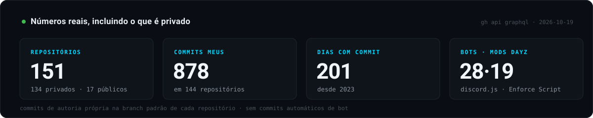

  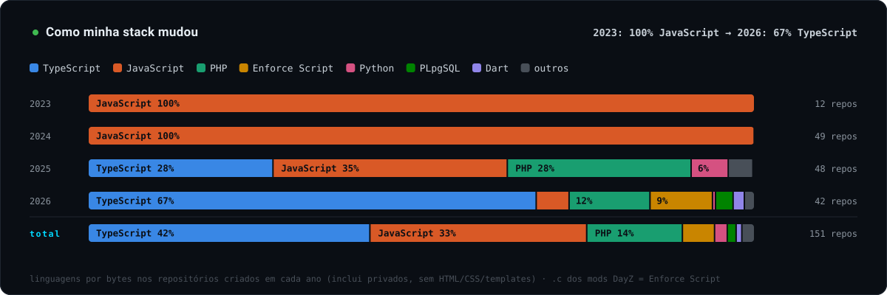

  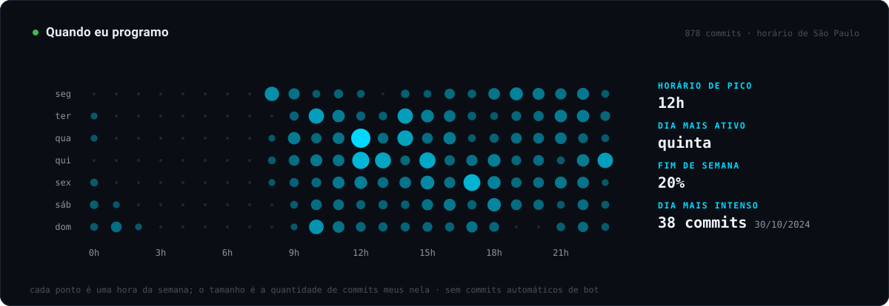

 

## Stack

  

 

## Mini-games

  <a href="https://maykontardoche.github.io/maykontardoche/games/deploy-rush/"></a>
  <a href="https://maykontardoche.github.io/maykontardoche/games/commit-stack/"></a>

Feitos do zero com Three.js, rodam no navegador do PC e do celular · <a href="games">código-fonte</a>

 

Tudo aqui é SVG gerado por <a href="scripts">scripts próprios</a>; os números são atualizados todo dia pelo GitHub Actions.

